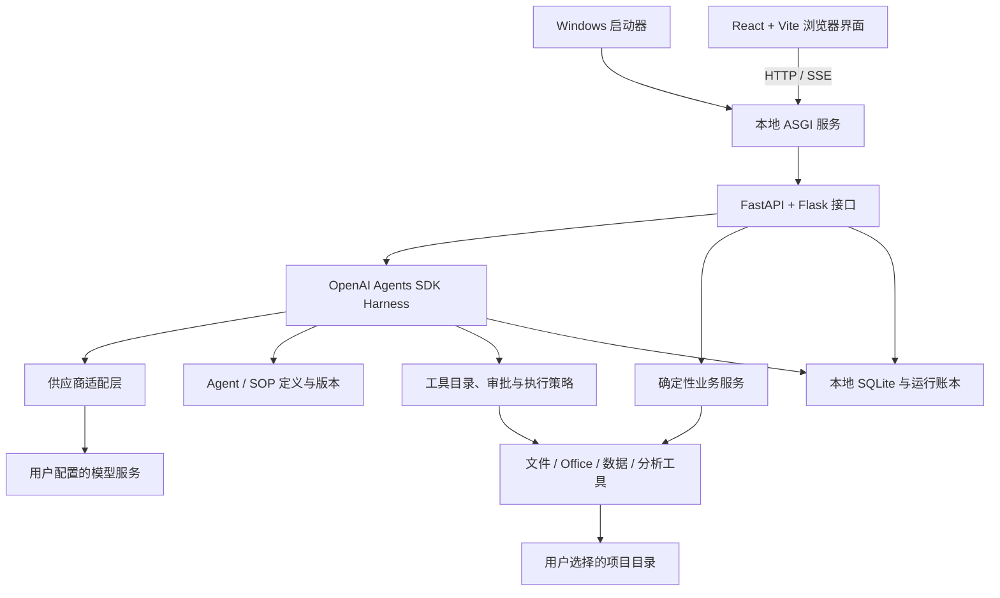

# SOPweave

> 本地优先的办公智能体工作台：用自然语言，把工作经验编织成可复用的 SOP。


SOPweave 是面向财务、办公和数据分析的本地 Agent Harness。它把项目文件、结构化数据库、Office 工具和 AI 对话放在同一个工作区，让用户完成任务，并将有效的工作过程保存为下次可调用的流程。

无需搭建节点图或编写脚本。描述需求、上传业务文档，或从已完成的对话中复盘，AI 就能协助整理 SOP；用户预览、修改并确认后发布。

**本机存储、自备模型 API、无广告、无平台账户、无平台额度系统。** AI 请求需要连接所配置的模型服务。

## 交给智能体部署

将下面整段提示词复制给能操作本地终端的编程智能体，让它拉取项目、检查环境、启动服务，并引导你完成首次使用。当前支持 Windows 10/11 x64。

```text
请帮我在本机部署并使用 SOPweave。
官方仓库：https://github.com/chienchen-png/Product-Finance-Agent-Workbench

请实际执行安装与验证，并用适合非技术用户的中文说明进度：

1. 先检查操作系统、Git、CPython 3.14 x64 和 Node.js 24 或 25。
   缺少依赖时，提供官方安装来源与步骤，引导我安装后继续；其他操作系统先说明目前的支持边界。
2. 在合适的本地目录执行：
   git clone https://github.com/chienchen-png/Product-Finance-Agent-Workbench.git SOPweave
   如果目标目录已存在，先检查内容和 Git 状态，不覆盖已有项目或用户数据。
3. 阅读仓库 README.md、CONTRIBUTING.md、sopweave/docs/LAUNCHER.md 和 OFFLINE.md，
   以当前检出的代码和文档为准。在仓库的 sopweave 目录，使用已确认的 Python 3.14 x64 执行：
   python -m venv .runtime
   .\.runtime\Scripts\python.exe -m pip install --require-hashes -r requirements.lock
   npm ci --prefix frontend
   npm run build --prefix frontend
   powershell -NoProfile -File scripts\build_launcher.ps1 -DesktopShortcut
4. 运行 .\.runtime\Scripts\python.exe scripts\check_runtime.py
   和 .\.runtime\Scripts\python.exe -m pip check，失败时定位原因后修复。
   不放宽依赖锁、不替换模型协议，也不修改应用业务代码来绕过安装错误。
5. 启动 .\SOPweave.exe，等待 /api/health 返回 success=true、data.product=sopweave、data.status=ready，
   然后打开 http://127.0.0.1:8080。端口冲突时使用 --port 8081，并同步调整验证地址。
6. 引导我在“设置 → 模型配置”中填写自己的供应商、API Key 和模型标识，完成五项能力检查。
   API Key 只在本机配置页面填写，不要求我把密钥发到聊天中，也不要打印密钥或提交到 Git。
7. 带我创建一个使用样例目录的测试项目，演示发送简单问题、导入人工样例表格、查看数据库，
   再演示在“财务 SOP”中从自然语言创建草稿、预览确认、发布，并在项目对话中选择调用。
   涉及真实模型调用时先说明会使用我的供应商额度；数据修改先用人工样例演示。
8. 最后告诉我：安装位置、启动入口、访问地址、数据与日志位置、如何停止服务，以及下一次如何打开。
   若有无法完成的步骤，明确记录失败命令和原因，不把尚未通过的步骤标记为成功。
```

## 核心特点

| 特点 | 实现方式 |
| --- | --- |
| 本地优先 | Web 服务、SQLite、项目文件、会话、报告和统计默认保存在本机 |
| 自然语言创建流程 | 从需求文字、文档或已完成对话生成 SOP 草稿，审阅后发布 |
| 可迁移的 SOP | 使用 Markdown/YAML 定义，支持 GitHub / ZIP Skill 导入与兼容性检查 |
| 统一智能体运行时 | 基于 OpenAI Agents SDK，处理流式输出、工具调用、询问、审批、停止与恢复 |
| 确定性业务工具 | 文件操作、Excel/Word、数据查询、财务计算、核对、图表与报告 |
| 按需加载 | 工具与 SOP 按任务发现和加载，减少无关上下文 |
| 可追踪执行 | 保存运行事件、工具结果、数据版本、变更日志和 Token 使用量 |
| 模型自选 | DeepSeek、智谱 GLM、硅基流动及自定义兼容服务 |

## 从工作经验到可执行 SOP

平台维护一个通用 Agent，SOP（Skill）描述具体业务的输入、工具、步骤和约束。用户创建流程即可，无需额外配置一个智能体。


- 左侧“财务 SOP”统一管理内置流程和用户流程；内置内容只读，用户 SOP 可新增、编辑、导入和删除。
- 项目输入框为每次发送选择 SOP 范围，运行开始后固定所用版本。
- 重要规则可由程序强制执行；金额计算、数据版本、写回校验和审批由确定性工具处理。
- GitHub / ZIP 导入先检查内容和兼容性，导入脚本不会自动执行。
- 已完成的对话可以整理为新 SOP 草稿，预览确认后再发布。

## 功能概览

| 功能 | 能力 |
| --- | --- |
| 项目空间 | 选择本地工作目录；浏览、搜索、上传、新建、编辑、复制、重命名、删除和引用文件 |
| AI 对话 | 流式文本与思考展示、工具过程、询问与审批、停止、断线恢复、上下文占用与清空 |
| 项目数据库 | 导入 XLS/XLSX；确认表头和字段；查看数据索引、来源坐标及修改日志；查询、修改与导出 |
| Excel / Word | 检查工作簿、按 Sheet / A1 范围读取和编辑；按文档块读取及修改 DOCX |
| 数据核对与校验 | 配置依据表和分表、匹配键及容差；计算差异，确认后写回允许处理的数据 |
| 财务建模与分析 | 财务报表、预测、预算、本量利、估值、比率、敏感性及时间序列等计算 |
| 图表与报告 | 交互式 ECharts；Markdown 报告预览、编辑、保存及 Word / PDF 导出 |
| 首页统计 | 今日 Token、AI 请求、运行成功／失败、使用时长；7／30 日趋势与供应商／模型排行 |

两个集成应用使用各自的隐藏工作区，共用模型适配和数据工具。项目数据库修改使用 revision 防冲突，外部文件发生变化时拒绝直接覆盖。

Word 导出需要 Pandoc；PDF 导出使用浏览器打印。普通 XLS/XLSX/DOCX 读取无需安装 Microsoft Office；缺少公式缓存时，重算可能需要 Excel 或 LibreOffice，详见[支持范围](sopweave/docs/SUPPORT.md)。

### 模型供应商

| 模板 | 默认 API 地址 | 协议 |
| --- | --- | --- |
| DeepSeek 官方 | `https://api.deepseek.com` | Chat Completions |
| 智谱 GLM 官方 | `https://open.bigmodel.cn/api/paas/v4` | Chat Completions |
| 硅基流动 | `https://api.siliconflow.cn/v1` | Chat Completions |

三家模板各自绑定适配方式，用户填写 API Key 和模型标识。自定义供应商需选择平台支持的协议、鉴权和思考参数格式，并填写 URL。

模型通过文本、流式文本、工具调用、工具结果续接和用量统计五项检查后，进入可调用列表。可用性仍受供应商额度、并发和模型能力影响。

### 工作模式

| 操作 | 人工审批 | 全自动 |
| --- | --- | --- |
| 读取文件、查询数据库 | 直接执行 | 直接执行 |
| 项目写入、数据修改、导出 | 用户确认 | 自动执行 |
| 本地 Python / Shell | 用户确认 | 用户确认 |
| SOP 强制审批规则 | 生效 | 生效 |

## 快速开始

### 环境要求

- Windows 10/11 x64，CPython 3.14 x64。
- Node.js 24 或 25：仅前端开发、构建时需要。
- 可访问的模型 API，以及用户自己的 API Key。

当前提供本地服务与原生 EXE 启动器。启动器负责启动服务、等待就绪并打开默认浏览器，运行时依赖与前端文件放在应用目录中。安装包及环境自动配置尚未提供。

### 从源码运行

在仓库根目录打开 PowerShell，确认 `python` 指向 CPython 3.14 x64：

```powershell
cd sopweave
python -m venv .runtime
.\.runtime\Scripts\python.exe -m pip install --require-hashes -r requirements.lock
npm ci --prefix frontend
npm run build --prefix frontend
powershell -NoProfile -File scripts\build_launcher.ps1 -DesktopShortcut
.\SOPweave.exe
```

启动器使用 Windows .NET Framework 的编译器构建，不需要另装 .NET SDK。`-DesktopShortcut` 可省略。

服务就绪后自动打开 `http://127.0.0.1:8080`。以后双击应用目录中的 `SOPweave.exe` 或桌面快捷方式即可启动。已有运行环境、前端产物和 EXE 时，无需重复构建。

- 重复启动会复用同一安装目录的服务。
- 关闭浏览器后服务继续运行；通过托盘菜单重新打开页面、查看日志或退出服务。
- EXE 与应用文件放在一起，桌面入口使用快捷方式。
- 端口冲突时使用 `.\SOPweave.exe --port 8081`。
- 诊断使用 `.\SOPweave.bat --check`；准备离线依赖见[离线安装](sopweave/docs/OFFLINE.md)。

### 首次使用

1. 打开“设置 → 模型配置”，添加供应商、API Key 和模型标识。
2. 运行模型能力检查，选择可用模型。
3. 创建项目并选择本地工作目录，上传或准备样例文件。
4. 需要数据分析时，先将表格导入项目数据库并核对字段。
5. 在输入框选择工作模式、SOP 和模型，发送任务。
6. 在“财务 SOP”创建流程，或将有效对话整理成 SOP 草稿。

完整操作见[用户指南](sopweave/docs/USER_GUIDE.md)。

## 架构



| 目录 | 职责 |
| --- | --- |
| `agent_profiles/`、`skills/` | 平台 Agent、内置 SOP 和参考资料；用户发布内容保存在本机数据目录 |
| `agent_runtime/` | 模型适配、运行管理、流式事件、上下文、工具策略与恢复 |
| `routes/`、`services/` | HTTP 输入与响应、业务编排 |
| `tools/` | 文件、Office、数据和财务计算执行层 |
| `storage/` | 项目、会话、数据索引、运行记录、日志与用量持久化 |
| `frontend/` | React 界面、前端测试与静态资源 |
| `launcher/`、`scripts/` | Windows 启动器源码、启动、构建、诊断和验证工具 |
| `config/` | 路径、运行参数、品牌及依赖锁解析 |
| `tests/`、`examples/` | 自动化回归与可公开分发的人工样例 |
| `docs/` | 当前使用、架构、运行时、分发说明和第三方许可 |

以上目录均位于仓库的 `sopweave/` 下。根目录保留 README、MIT 许可、安全说明、贡献指南和 CI 配置。

### 源码、环境与数据

- `requirements.txt` 是完整依赖声明，`requirements.lock` 锁定安装版本及哈希；`requirements-agent.in/lock` 用于 Agent SDK 升级约束。
- `.runtime/`、`frontend/node_modules/` 是本机依赖，`frontend/dist/` 与 `SOPweave.exe` 是构建产物，不提交源码仓库。运行预构建应用需要保留前端产物。
- `data/` 保存本机配置、数据库、SOP、运行状态和结果；用户工作目录可以独立于安装目录。
- `SOPWEAVE_DATA_DIR` 可指定数据目录，相对值以应用目录为基准。
- 迁移到其他电脑时重新准备 Python 环境，完整迁移数据及项目文件；虚拟环境不能直接复制复用，外部项目目录变化后需重新选择。

## 数据与隐私

默认仅监听 `127.0.0.1`，不提供公网多用户服务。无平台登录、云同步、广告或在线额度系统。Agents SDK tracing 默认关闭。

项目、会话、数据库、运行日志和用量统计保存在本机。API Key 保存在本机配置数据库，不随源码分发。模型请求会将输入及任务选取的数据发送到所配置的供应商；本地运行不代表远程模型调用离线。

请勿提交 `data/`、密钥、真实财务文件或数据库。备份应同时覆盖数据目录及用户选择的项目目录。安全边界见 [SECURITY.md](SECURITY.md)。

## 开发与验证

在 `sopweave` 目录中，先构建前端与启动器，再运行回归：

```powershell
npm run build --prefix frontend
powershell -NoProfile -File scripts\build_launcher.ps1
.\.runtime\Scripts\python.exe -m unittest discover -s tests -t .
npm test --prefix frontend
.\SOPweave.bat --check
.\.runtime\Scripts\python.exe -m pip check
```

测试使用临时数据和人工样例。启动器测试会实际启动隔离服务，检查重复启动、退出清理、端口冲突及目录迁移。

真实模型测试需单独提供 Key，会产生供应商请求；日常回归不使用用户密钥。开发约定、依赖更新与发布门槛见 [CONTRIBUTING.md](CONTRIBUTING.md)。

## 文档与支持边界

- [用户指南](sopweave/docs/USER_GUIDE.md)
- [架构说明](sopweave/docs/ARCHITECTURE.md)
- [Agent 运行时与工具](sopweave/docs/AGENT_RUNTIME.md)
- [Windows 启动器](sopweave/docs/LAUNCHER.md)
- [离线安装与分发](sopweave/docs/OFFLINE.md)
- [支持范围与数据流](sopweave/docs/SUPPORT.md)
- [第三方许可](sopweave/docs/THIRD_PARTY_NOTICES.md)

当前重点支持 Windows x64 和普通 XLS/XLSX/DOCX。宏、复杂外链、嵌入对象、修订痕迹和复杂图表需按文件验证。自定义模型服务必须满足平台支持的 Chat Completions 契约。

欢迎贡献办公 SOP、确定性业务工具、模型适配、Office 保真改进、界面优化和可复现的缺陷测试。

## 开源许可

项目采用 [MIT License](LICENSE)。随附的第三方依赖及资源遵循各自许可，见第三方声明。
